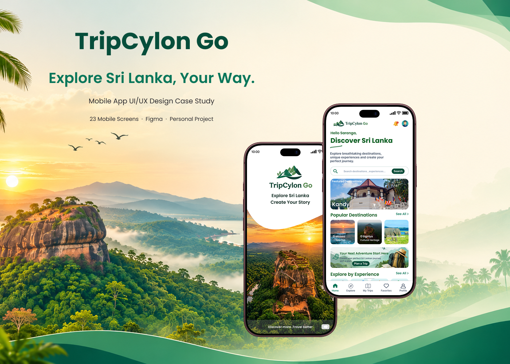

# TripCylon Go – Mobile App UI/UX Design

### Explore Sri Lanka, Your Way 🇱🇰

TripCylon Go is a personal UI/UX design project focused on creating a modern, user-friendly mobile travel application that helps users discover Sri Lankan destinations, explore travel experiences, and plan their trips conveniently.

The project brings destination discovery, travel inspiration, itinerary planning, and trip management together in a simple and visually engaging mobile experience.

---

## 📱 Project Preview

  

---

## ✨ Key Features

- **Destination Discovery** – Explore beautiful destinations across Sri Lanka.
- **Travel Experiences** – Discover nature, wildlife, adventure, culture, and more.
- **Travel Guides** – Access travel inspiration and destination information.
- **Trip Planning** – Select destinations and travel dates to organize trips.
- **Itinerary Management** – View and manage planned trips.
- **Favorites** – Save favorite destinations and experiences.
- **User Profile** – Manage personal information and account settings.
- **Notifications** – Receive trip updates, travel tips, and recommendations.
- **Authentication UI** – Login, registration, and password recovery screens.
- **Settings** – Manage app preferences and account settings.
- **About Us** – Learn more about TripCylon Go.
- **Help & Support** – Access assistance and support information.

---

## 🎨 Design System

| Element | Specification |
|---|---|
| Primary Color | `#064E3B` |
| Secondary Color | `#08765A` |
| Background | `#FAF8F2` |
| Accent Color | `#DDF3E7` |
| Heading Font | Poppins |
| Body / UI Font | Inter |
| Design Tool | Figma |

The visual design follows a nature-inspired aesthetic, using emerald green tones, warm backgrounds, clean typography, and rounded UI components.

---

## 📲 Designed Screens

The project includes **26 mobile application UI screens**, organized into the following categories:

### Authentication
- Splash Screen
- Welcome / Onboarding
- Login
- Register
- Forgot Password
- Reset Password

### Discover Sri Lanka
- Home
- Destinations
- Destination Details
- Experiences
- Travel Guides
- Experience Category Details
- Experience Details
- Travel Guide Details
- Notifications

### Trip Planning
- Trip Planner
- Select Destinations
- Select Travel Dates
- My Trips / Itinerary
- Itinerary Details

### Personalization & Account
- Favorites
- Profile
- Edit Profile
- Settings
- About Us
- Help & Support

---

## 🛠️ Tools & Technologies

- Figma
- UI/UX Design
- Mobile App Design
- Interactive Prototyping

---

## 🎯 Project Goals

- Design an intuitive mobile travel experience.
- Improve destination discovery and trip planning experiences.
- Maintain consistency across all mobile screens.
- Create a clear navigation structure.
- Develop a visually appealing and accessible interface.

---

## 👨‍🎨 My Role

**UI/UX Designer**

Responsibilities:
- Concept development
- UI design
- Visual design system
- Screen design
- Navigation structure
- Interactive prototyping

---

## 🔗 Design & Prototype

- **Figma Design:** (https://www.figma.com/design/giUqXQ2QkPnU4cPXM5Kr7M/trip-cylon-go?node-id=0-1&t=7cxLlvh0GdIj1aLJ-1)
- **Interactive Prototype:** (https://www.figma.com/proto/giUqXQ2QkPnU4cPXM5Kr7M/trip-cylon-go?node-id=4-5&viewport=2205%2C-3043%2C0.09&t=5Yns48x6B1DTR3Kv-1&scaling=scale-down&content-scaling=fixed&starting-point-node-id=277%3A468&page-id=0%3A1)

---

## 🚀 Future Improvements

- Conduct user research and usability testing.
- Improve accessibility and interaction design.
- Integrate real-time travel information.
- Develop functional trip planning features.
- Implement the mobile application.

---

## 📄 License

This project is created for personal portfolio and educational purposes.

---

**TripCylon Go – Explore Sri Lanka, Your Way.** 🌿
